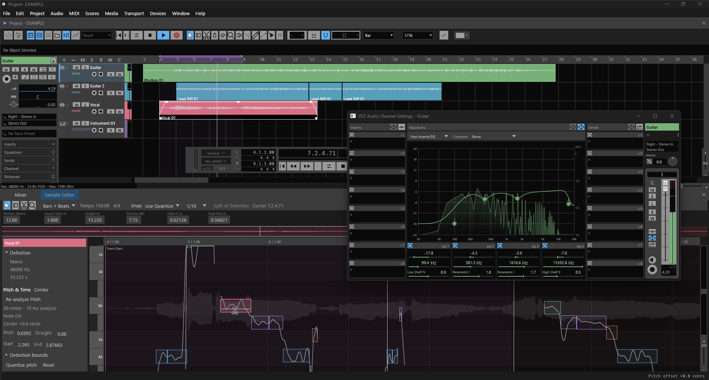
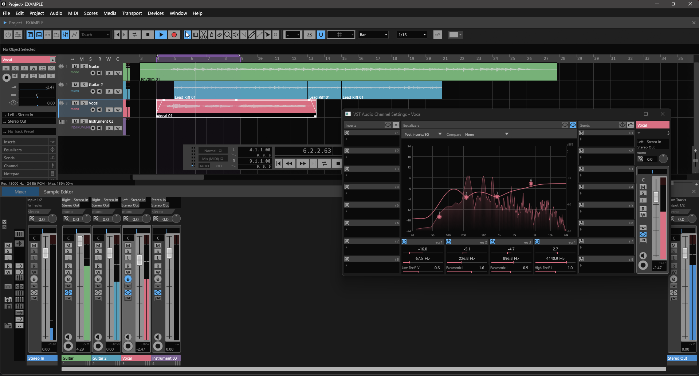

<p align="center">
  <picture>
    <source media="(prefers-color-scheme: dark)" srcset="docs/images/opentrack-logo-dark.png">
    
  </picture>
</p>

# OpenTrack

OpenTrack is a standalone open source DAW built in Rust. Its goal is to provide a dependable, expressive environment for recording, editing, arranging, mixing, and finishing music.





*The current Windows development build displaying the EXAMPLE project: Vocal channel editing and the Guitar Sample Editor with Pitch & Time notes.*

## What we are building

- **A complete creative workflow:** audio and MIDI recording, timeline editing, arrangement, mixing, and export in one application.
- **Responsive, predictable editing:** accurate transport controls, grid snapping, loop ranges, smooth navigation, and dependable undo and redo.
- **A capable mixing environment:** track routing, monitoring, automation, channel processing, and support for third-party instruments and effects.
- **Projects you can trust:** reliable saving, media management, recovery, and consistent recall of your work and workspace.
- **A flexible desktop workspace:** clear controls, useful shortcuts, configurable layouts, and a polished interface that keeps everyday actions close at hand.
- **Interoperable projects:** import and export supported DAW project formats while retaining unsupported metadata where the format allows.
- **An extensible foundation:** a Rust application and audio engine that can grow through community contributions and independently designed instruments and effects.

Development prioritizes complete, usable musical workflows. Functionality, reliability, and interface polish are reviewed together as the application grows.

## Development status

OpenTrack is an early prototype under active development. The current application includes a Project timeline, track controls and Inspector, Mixer, Channel Settings with four-band EQ, floating transport, WAV import and playback, basic audio recording, MIDI editing, and native project saving.

These pieces are still being integrated and tested. Advanced routing, automation, general third-party plug-in hosting, and a complete production workflow remain development goals. Visible controls may still be incomplete. Recording and monitoring still require validation with real audio hardware.

New projects use the `.opr` format. Earlier `.otp` and `.rwp` project files remain readable.

## Build and run

The primary target is **64-bit Windows**. Install Rust with the MSVC toolchain and the Visual Studio C++ build tools, then run this from the repository root:

```powershell
powershell -NoProfile -ExecutionPolicy Bypass -File .\build.ps1 -Architecture x64
```

Launch `builds/x64/OpenTrack.exe`. Close any running OpenTrack instance before rebuilding. The execution-policy option applies only to this build process.

Add `-LocalAsio` to include the optional local ASIO adapter alongside WASAPI. Subsequent builds retain the previous backend selection for that architecture, recorded in `builds/x64/build-info.json`. Use `-LocalAsio:$false` to explicitly build with WASAPI only.

## Contributing

Contributions that make real musical workflows more reliable and useful are welcome. Useful work includes reproducing bugs, improving editing and audio behavior, reviewing accessibility and interaction, testing with audio and MIDI hardware, and refining the interface.

Keep changes focused, describe the expected behavior, and include meaningful verification. Distinguish working features from planned functionality so users and contributors can follow progress accurately.
