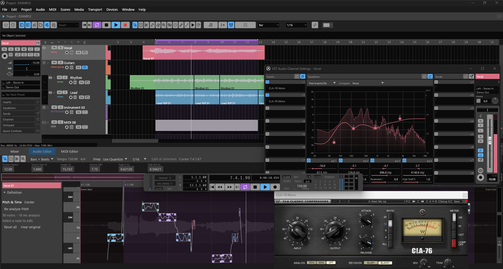
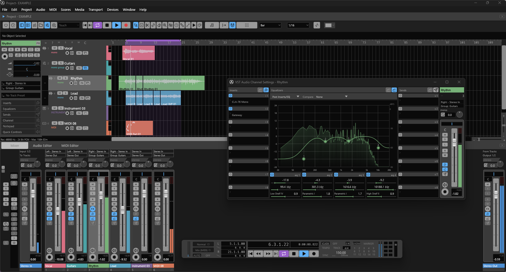
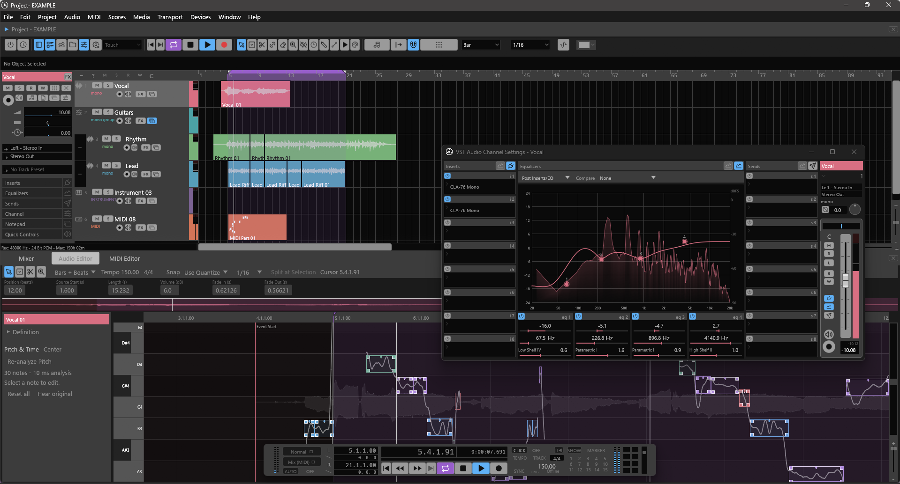

<table align="center" width="100%" bgcolor="#292929">
  <tr><td align="center">
    
  </td></tr>
</table>

# OpenTrack

OpenTrack is a standalone open source DAW built in Rust. Its goal is to provide a dependable, expressive environment for recording, editing, arranging, mixing, and finishing music.

**License:** [Apache License 2.0](LICENSE).



*OpenTrack's full workspace during playback, with the Project, Audio Editor, Mixer, Channel Settings, and VST effect visible together.*

<details>
<summary>More workspace views</summary>



*Project timeline and Mixer with Channel Settings open.*



*Audio Editor and Channel Settings for the Vocal track.*

</details>

## Development status

OpenTrack is an early prototype under active development. Its features are still being integrated and reviewed, and some visible controls are incomplete. The following describes the current development version; availability does not imply that every workflow has completed runtime or hardware validation. The status below is refreshed with every delivered slice.

### What works today

- **Arranging:** audio, MIDI, instrument and group tracks; transport and cycle playback; bar/beat/quantize snapping plus snapping to event edges or the cursor; zoom commands; follow-playhead scrolling; markers with next/previous navigation and a marker list; event nudge, edge nudge, split at cursor or at both locators, glue, range delete and crossfades; MIDI part split and merge; bounded undo/redo with an undo-history window.
- **Recording:** audio and MIDI capture; punch in/out driven by the locators; per-track input monitoring (Off, Auto while armed, On); each loop pass recorded to its own take lane; a metronome with a per-beat accent pattern and a count-in.
- **Media:** imported WAVs copied into the project; media pool; consolidation into the project folder; missing-media relink; unused and missing pool cleanup; several timestamped recovery points.
- **Mixing:** Mixer and Channel Settings; input gain and metering; 32-band static and dynamic EQ; live spectrum and tonal-reference analysis; insert rack; up to 24 sends per channel with typed routing.
- **Automation:** track volume records from live fader movement, plays back, and is editable as points. Automation on the input and output buses is not implemented, so those Write controls stay disabled.
- **Plug-ins:** third-party VST3 effect hosting with native editor windows. Compatibility varies by plug-in; universal VST3 support is not claimed.
- **Editing tools:** MIDI editor with note and controller lanes, quantize with strength and swing, transpose and velocity tools; Sample Editor with on-demand Pitch & Time analysis and editing.
- **Delivery:** stereo WAV mixdown, per-track stem export, bounce in place through a track's own chain, and Standard MIDI File export of the whole project or a selection.
- **Project tools:** templates, session health check, project statistics, beat calculator, and a notepad saved with the project.
- **Platform and format:** Windows x64 is the primary target and Kubuntu Linux has been verified. The native project format is OPR (`.opr`, currently version 28); earlier `.opr`, `.otp` and `.rwp` files remain readable, and older builds refuse a newer file instead of stripping fields they do not know.

### What still needs work

- **Real-device review:** recording, punch, monitoring, loop takes, the metronome click, stem export, bounce and mixdown pass offline and headless checks but still need listening and hardware validation. Those results are not claimed yet.
- **Automation coverage:** input/output-bus automation and its Write controls are missing; track automation still needs live-device testing.
- **Routing:** device-bus sends and wider physical channel maps are open. Track and group sends and typed routing pass offline checks and still need live review.
- **Interchange:** CPR is inspection-only; a real adapter waits for sample files. Other DAW formats are future work. Authored MIDI fixtures pass; comparison with DAW-produced MIDI files remains.
- **Interface completion:** 122 menu entries are still shown disabled and 122 of 152 keymap-bound commands have a working shortcut. The [accessibility and keyboard report](docs/workflow/accessibility-2026-11-02.md) lists the gaps; a manual keyboard-only pass is pending.
- **Linux plug-ins:** VST3 editor embedding on Linux is not implemented.
- **Not available:** video, surround, score editing, macOS and browser builds, and a command-line or MCP interface. Plug-in compatibility and recovery behavior need continued verification.

### Highlights

- **32-band EQ with dynamic processing:** shape a channel with multiple filter types and independent dynamic controls for each band.
- **Built-in spectrum and tonal-reference analysis:** compare live audio with another channel or a captured or imported WAV reference.
- **Up to 24 insert and send slots per channel:** insert slots run available built-in processors and third-party VST3 effects, including native plug-in editor windows. Track and group sends have destination, level, pan, and pre/post-fader controls; the signal path passes offline tests and still needs live hardware review. Device-bus sends remain unavailable.
- **Integrated Pitch & Time:** analyze and edit audio in the Sample Editor, alongside the Project and Mixer workspace.
- **Windows audio choices:** use WASAPI, or enable the optional local ASIO adapter for a compatible installed driver.
- **Platform:** Windows x64 is the primary build target. Kubuntu Linux was part of development and has been built and verified.

### Built-in EQ and analysis

Channel Settings includes an EQ and analyzer for shaping and inspecting a channel:

- **Up to 32 EQ bands:** add and adjust bands on the graph, with frequency, gain and Q controls, individual band enable and solo, and an overall EQ bypass.
- **Filter choices:** constant-Q and proportional-Q bell filters, low- and high-pass filters, and several low- and high-shelf shapes.
- **Dynamic EQ:** independently enable dynamic processing on a band and adjust threshold, range, attack and release. The graph shows the allowed range and live gain movement.
- **Live spectrum:** view pre- or post-processing signal, compare another channel, and adjust the display range, tilt and FFT resolution. Peak hold and freeze help inspect the display.
- **Tonal reference:** capture a target from playback or import a WAV reference, then compare a longer-term tonal profile against the saved target. Targets are stored with the project.

These features are under active development; live listening, visual behavior and performance across audio devices still need further review.

### Near-term priorities

User-side review of the recording, delivery and listening features above; the CPR adapter once real `.cpr` files are available; the remaining disabled menus and undispatched shortcuts; and a Linux VST3 editor path with a test plug-in. Windows x64 remains the primary target.

Progress and verification live in [the current workflow state](docs/workflow/current.md), the [revision-2](docs/workflow/roadmap-32-steps-v2.md) and [revision-3](docs/workflow/roadmap-32-steps-v3.md) roadmaps, and the [accessibility report](docs/workflow/accessibility-2026-11-02.md).

## Build and run

The primary build target is **64-bit Windows**. Kubuntu Linux was part of development and has also been built and verified; other Linux distributions, macOS and browser builds are not current release claims. On Windows, install Rust with the MSVC toolchain and the Visual Studio C++ build tools, then run this from the repository root:

```powershell
powershell -NoProfile -ExecutionPolicy Bypass -File .\build.ps1 -Architecture x64
```

Launch `builds/x64/OpenTrack.exe`. Close any running OpenTrack instance before rebuilding. The execution-policy option applies only to this build process.

Add `-LocalAsio` to include the optional local ASIO adapter alongside WASAPI. Subsequent builds retain the previous backend selection for that architecture, recorded in `builds/x64/build-info.json`. Use `-LocalAsio:$false` to explicitly build with WASAPI only.

## Contributing

Contributions that make real musical workflows more reliable and useful are welcome. Useful work includes reproducing bugs, improving editing and audio behavior, reviewing accessibility and interaction, testing with audio and MIDI hardware, and refining the interface.

Keep changes focused, describe the expected behavior, and include meaningful verification. Distinguish working features from planned functionality so users and contributors can follow progress accurately.

## License

OpenTrack's original application and workspace source are licensed under Apache-2.0. See [LICENSE](LICENSE). Third-party dependencies, bundled artwork and the optional ASIO component retain their own licenses; see [third-party notices](docs/third-party-notices.md) and the notices beside bundled assets.
